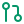

<!-- readme-standard: 2026-11-02 -->

# ORG brand assets

*Canonical logo files for the Octagon Religious-Research Group: the existing marks, not a redesign.*

 **You are here:** Octagon Religious-Research Group › `brand-assets` · public · `main` is the working branch

##  TL;DR

1.  **What this is.** The logo, avatar and favicon files ORG uses, listed below with what each is for.
2.  **Who it is for.** Members, working groups and press, and anyone who wants to say who ORG is.
3.  **Do this first.** Read [`BRAND-GUIDELINES.md`](BRAND-GUIDELINES.md) before using the mark.

Canonical logo files for the Octagon Religious-Research Group (ORG). These are the existing marks
from orgspirituality.org, not a redesign.

| File | Use |
|---|---|
| `avatar-512.png` | GitHub org/profile picture (square, 512×512) |
| `logo-original.jpeg` | Original full-resolution mark |
| `favicon-32.png` | Browser favicon (fallback for ORG GitHub Pages sites) |
| `apple-touch-icon-180.png` | iOS home-screen icon |
| `icon-192.png` | PWA / Android icon |

Read [`BRAND-GUIDELINES.md`](BRAND-GUIDELINES.md) before using the mark.

> **The ownership, licence and trademark wording here is a draft for ORG's officers and community.
> It is not legal advice** and has not been reviewed by a lawyer.

##  Who owns the marks, and what may be done

The name **Octagon Religious-Research Group**, **ORG** and the **octagon mark** belong to the
Octagon Religious-Research Group. No registration is claimed in these files.

- **You may** use the name factually, to say who ORG is or what a thing came from.
- **Members, working groups and press** may use the mark as [`BRAND-GUIDELINES.md`](BRAND-GUIDELINES.md) describes.
- **Everything else needs a yes first:** merchandise, partnerships, commercial use, modified versions.
  Ask at org@orgspirituality.org or through [orgspirituality.org](https://orgspirituality.org).

##  Palette

The mark is a rendered image, a glowing rainbow octagon, so it has no flat colours to list: use the
files as they are. The websites' colours are the three lights in
[`arrival/org.css`](https://github.com/Octagon-Religious-Research-Group-ORG/Octagon-Religious-Research-Group-ORG.github.io/blob/main/arrival/org.css).

| Colour | Night Sanctuary | Prism Light | Stone & Lapis |
|---|---|---|---|
| Background | `#100e1c` | `#f5f3fa` | `#ecebe6` |
| Text | `#eee8f6` | `#221d33` | `#1b2433` |
| Accent | `#e9be72` | `#6b4fa0` | `#22408a` |
| Heading type | Fraunces | Newsreader | Marcellus |
| Body type | Manrope | Hanken Grotesk | Literata |

Visual direction for the website is being decided by community vote; this repository only holds the
current logo files, and these colours are not ORG's final brand.

##  License

- **Everything here is all rights reserved**, see [`LICENSE`](LICENSE). Please ask before reproducing or redistributing.
- **Names, logos and marks:** see [`TRADEMARKS.md`](TRADEMARKS.md)

##  Suggest a change

Noticed something? Open an [issue](../../issues) or a pull request against `main`; a person with the role merges with a merge commit, and the ownership, licence and trademark wording is for ORG's officers and community to settle. Not on GitHub? Write to [org@orgspirituality.org](mailto:org@orgspirituality.org).

This front door follows the living [README standard](https://github.com/drasticstatic/my-template/blob/main/README-STANDARD.md). Copy it, improve it. Icons: Lucide (ISC), see <code>assets/icons/LICENSE</code>.
